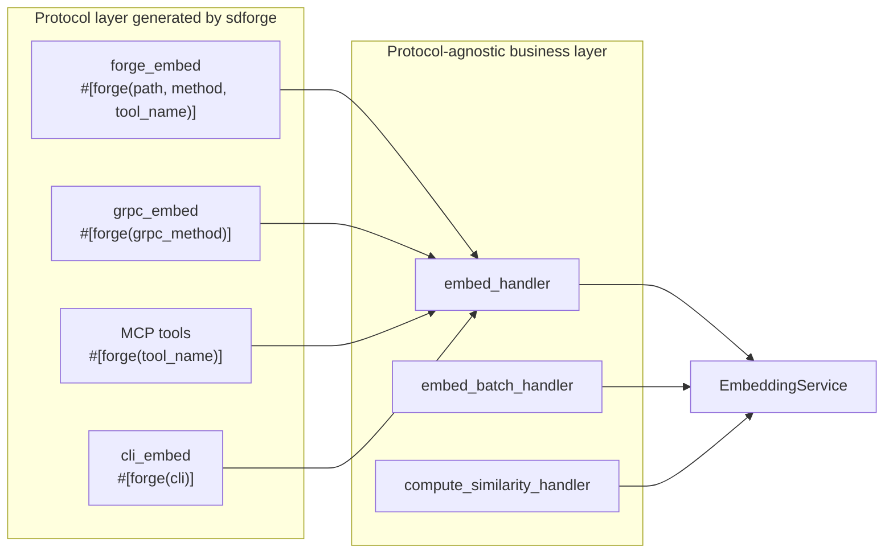
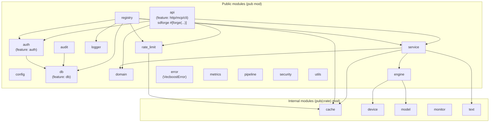
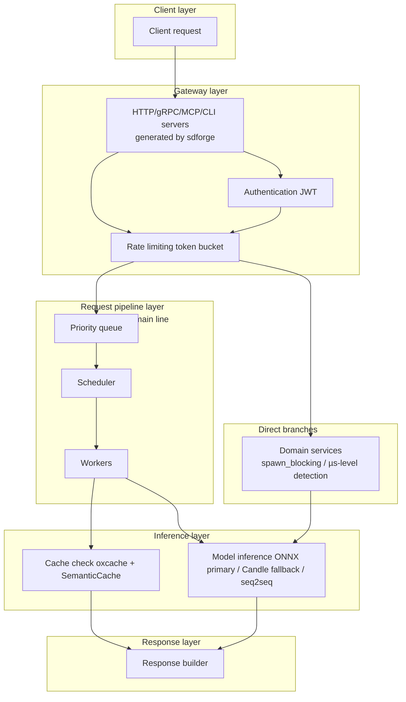
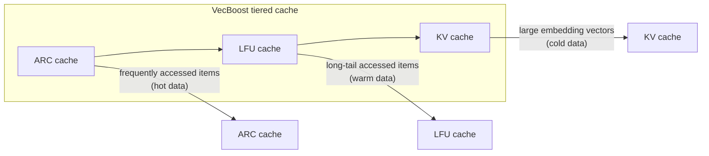
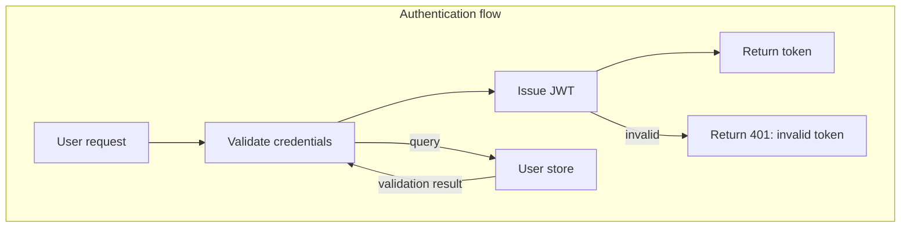
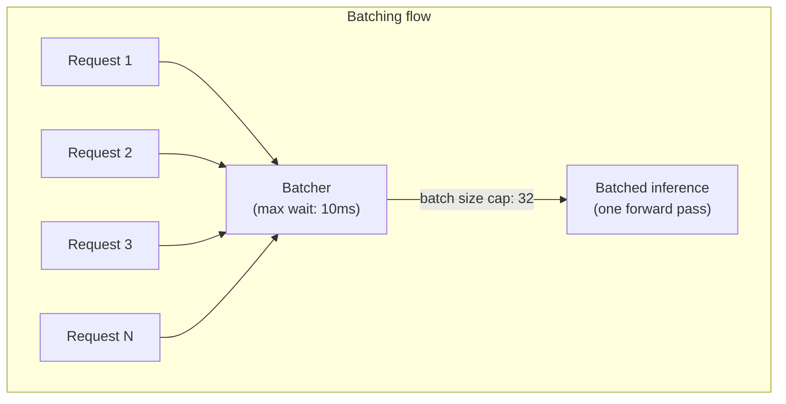
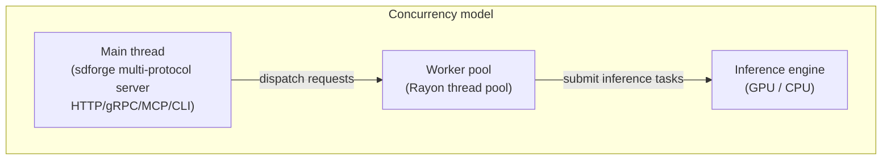
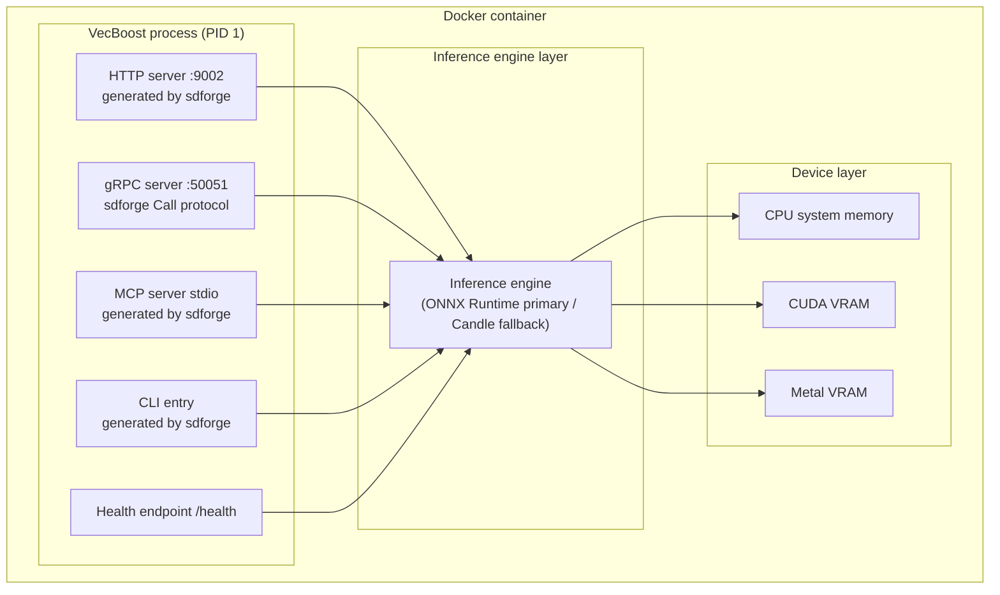

# 🧱 VecBoost Architecture

**Internal architecture, key components, data flow, and design decisions in detail**

[](https://github.com/Kirky-X/vecboost/releases) [](https://www.rust-lang.org/) [](https://www.apache.org/licenses/LICENSE-2.0)

*The internal architecture of VecBoost, explaining key components, data flow, and design decisions.*


---

## 📋 Table of Contents

<details open>
<summary>📑 Table of Contents (click to expand)</summary>

- [Overview](#-overview)
- [Core components](#-core-components)
- [Module dependency graph](#-module-dependency-graph)
- [Data flow](#-data-flow)
- [Request pipeline](#-request-pipeline)
- [Cache architecture](#-cache-architecture)
- [Security architecture](#-security-architecture)
- [Configuration system](#-configuration-system)
- [Performance optimization](#-performance-optimization)
- [Deployment architecture](#-deployment-architecture)
- [Extension points](#-extension-points)
- [Test architecture](#-test-architecture)
- [Internationalization (i18n)](#-internationalization-i18n)
- [Error handling](#-error-handling)
- [Core dependency acknowledgements](#-core-dependency-acknowledgements)
- [Related documentation](#-related-documentation)

</details>

---

## 📌 Overview

VecBoost is a **multi-task inference service** built in Rust. It provides an extensible, production-ready solution for text vectorization, including enterprise-grade capabilities.

### 🎯 Design goals

| Goal | Description | How it is achieved |
|------|------|----------|
| **High performance** | Minimize latency | Batching, concurrent execution, efficient memory management |
| **Scalability** | Horizontal scaling | Kubernetes-native support |
| **Reliability** | Stable operation | limiteron token-bucket rate-limit backpressure (Governor's built-in circuit breaker, not a user-configurable knob), retry mechanisms, health checks |
| **Security** | Enterprise-grade security | Authentication, authorization, audit logging |
| **Flexibility** | Multi-engine support | ONNX Runtime primary engine (onnx-primary), Candle opt-in fallback abstraction |

---

### 🔨 Technology stack

| Layer | Technology | Role |
|------|----------|------|
| **Language** | Rust 2024 Edition | High performance, memory safety |
| **Protocol generation** | sdforge | Generates HTTP/gRPC/MCP/CLI bindings uniformly via the `#[forge(...)]` macro |
| **Web framework** | Axum 0.8 | Underlying HTTP/REST runtime (generated by sdforge, not hand-written) |
| **gRPC** | sdforge unified Call protocol | Registered via `#[forge(grpc_method = "...")]`, started by `build_server_with_config` |
| **MCP** | rmcp 2.1 | Model Context Protocol server; tools registered via `#[forge(tool_name = "...")]` |
| **CLI** | clap 4.6 | Command-line interface (generated by sdforge, not hand-written) |
| **ML inference** | ONNX Runtime 2.0 (`ort`) | **Default primary engine** (onnx-primary; the `onnx` feature ships with default) |
| | Candle 0.11 | opt-in fallback backend (native Rust, Bert / XlmRoberta architectures, no optimization investment) |
| **GPU acceleration** | CUDA 12.x | NVIDIA GPUs (ort via `ort/cuda`; the candle backend via `candle-cuda` opt-in) |
| | Metal | Apple Silicon (`metal` feature, exclusive to the candle fallback backend) |
| **Configuration** | confers (TOML + env + config-bus) | Config parsing (mandatory dependency; hand-writing config is forbidden) |
| **Logging** | inklog + log | Logging infrastructure (mandatory dependency; hand-writing tracing is forbidden) |
| **Caching** | oxcache | Cache infrastructure (mandatory dependency; hand-writing LRU is forbidden) |
| **Rate limiting** | limiteron | Rate-limit infrastructure (mandatory dependency; hand-writing is forbidden). Built on limiteron's native `TokenBucketLimiter` + `Limiter` trait with independent Global/Ip/User/ApiKey dimensions |
| **Module registry** | trait-kit | Module registry and dependency injection (mandatory dependency) |
| **Observability** | Prometheus 0.14 + log | Metrics and logs |

### 🧩 The 7-library ecosystem (crates.io releases)

| Library | Version | Purpose | Feature |
|----|------|------|---------|
| **trait-kit** | `0.5.0-rc.10` | Module registry and typestate dependency management (`Kit<Unbuilt> → Kit<Ready>`) | Always enabled |
| **confers** | `0.6.0-rc.11` | Configuration loading (TOML + env overrides + hot-reload subscription) | Always enabled |
| **inklog** | `0.3.0-rc.10` | Structured logging infrastructure (console + file rotation) | Always enabled |
| **oxcache** | `0.5.0-rc.10` | High-performance cache backend (LRU/LFU/FIFO + TTL eviction) | Always enabled |
| **limiteron** | `0.3.0-rc.8` | Token-bucket rate limiter (independent per-dimension counting) | Always enabled |
| **dbnexus** | `0.6.0-rc.10` | Database persistence (SQLite/PostgreSQL + permission roles) | `db` |
| **sdforge** | `0.5.0-rc.9` | Multi-protocol interface generation (HTTP/gRPC/MCP/CLI from single-source definitions) | `http`/`grpc`/`cli`/`mcp` |

> All seven libraries currently come from the crates.io registry (`Cargo.toml` has no `path =` dependencies and no `[patch]`; `Cargo.lock` records `source = "registry+https://github.com/rust-lang/crates.io-index"`). The root `Cargo.toml` is authoritative for versions.

---

## 🧩 Core components

### Application state

The `VecboostState` struct (defined in `src/lib.rs`) holds all shared state used by route handlers. After the v0.3.0 refactor, all capabilities are managed uniformly through trait-kit's `AsyncKit<AsyncReady>` instead of standalone fields:

```rust
pub struct VecboostState {
    /// trait-kit AsyncKit — the module capability management center
    /// Capability query entry: `src/registry/impl_.rs` has 20 production `ModuleMeta` implementations (plus 3 Composite test fixtures; some gated by features such as `auth`)
    pub(crate) kit: Arc<trait_kit::AsyncKit<trait_kit::AsyncReady>>,
}
```

Route handlers retrieve capabilities via `state.kit.require::<M>()`, or get them injected automatically through Axum's `FromRef`. Boolean configs (such as `AuthEnabled`, `RateLimitEnabled`, `PipelineEnabled`) are queried directly via `state.kit.config::<T>()` without registering standalone Modules.

---

### 🔌 Protocol generation layer (sdforge)

VecBoost generates HTTP/gRPC/MCP/CLI bindings uniformly through the **sdforge** framework; hand-writing Axum handlers, tonic gRPC, clap CLI, or proto files is **forbidden**. Protocol handler functions are defined per business domain in the single sources under `src/api/` (`embedding.rs` / `rerank.rs` / `decisions.rs` / `translate.rs` / `detect.rs`) and annotated with the `#[forge(...)]` macro to generate each protocol's bindings.

#### Architecture design: protocol-agnostic handlers



| Protocol | Macro annotation | Enabling feature | Example entry function |
|------|--------|--------------|--------------|
| **HTTP** | `#[forge(path = "/embed", method = "POST", tool_name = "embed_text")]` | `http` | `forge_embed` |
| **gRPC** | `#[forge(grpc_method = "vecboost.embed")]` | `grpc` | `grpc_embed` |
| **MCP** | `#[forge(tool_name = "embed_text")]` | `mcp` | (reuses the HTTP forge) |
| **CLI** | `#[forge(...)]` + `cli_*` functions | `cli` | `cli_embed` |

**Core design**: the protocol-specific `forge_*` / `cli_*` / `grpc_*` functions are thin wrappers that only attach the `#[forge(...)]` macro; the actual business logic lives in the protocol-agnostic `*_handler` functions (such as `embed_handler`, `embed_batch_handler`). This removes about 96 lines of duplicated state-fetch/validation/dispatch code across the three protocols.

**gRPC startup**: started via `sdforge::grpc::build_server_with_config(&addr, config)` using the unified `SdForgeService/Call` RPC protocol; requests/responses pass domain types as JSON through `CallRequest.data` / `CallResponse.data`.

---

### 🔧 Embedding service

`EmbeddingService` (`src/service/embedding.rs`) is the core service, coordinating:

| Concern | Module | Description |
|------|------|------|
| **Text processing** | `src/text/` | Chunking, tokenization, aggregation |
| **Inference execution** | `src/engine/` | Engine abstraction and implementations |
| **Result caching** | `src/cache/` | Multi-tier caching strategy |

```rust
pub struct EmbeddingService {
    engine: Arc<RwLock<dyn InferenceEngine + Send + Sync>>, // inference engine
    validator: InputValidator,                              // input validator
    model_config: Option<ModelConfig>,                      // model configuration
    model_manager: Option<Arc<ModelManager>>,               // model manager
    cache: Arc<OxCacheBackend>,                             // oxcache cache backend
    memory_manager: Option<SharedGpuMemoryManager>,         // GPU memory management
    buffer_pool: Option<Arc<RwLock<BufferPool>>>,           // GPU buffer pool
    semantic_cache: Option<Arc<SemanticCache>>,             // semantic cache
    memory_limit: Option<Arc<MemoryLimitController>>,       // model-resident memory cap enforcement
    memory_used_est: AtomicU64,                             // currently accounted model bytes
    checkpoints: Option<BTreeMap<String, CheckpointPreset>>, // [model.checkpoints] preset table
}
```

> **⏱️ Batching basis**: the former `batch_scheduler` (DynamicBatchScheduler) and `continuous_batch_loop` (ContinuousBatchLoop) fields retired with their components in `f70016e`, replaced by **time-window batching**; `EmbeddingService` no longer holds either (batching is assembled on the pipeline worker side). See the retirement note in [⚡ Performance Guide](PERFORMANCE.md).

---

### ⚡ Inference engines

The engine abstraction (`src/engine/mod.rs`) provides a unified interface over different ML runtimes:

```rust
#[async_trait]
pub trait InferenceEngine: Send + Sync {
    /// Run inference, returning an L2-normalized vector (engine exit contract, identical across all three engines)
    fn embed(&self, text: &str) -> Result<Vec<f32>, VecboostError>;

    /// Batch inference
    fn embed_batch(&self, texts: &[String]) -> Result<Vec<Vec<f32>>, VecboostError>;

    /// Get the current precision setting
    fn precision(&self) -> &Precision;

    /// Check whether mixed precision is supported
    fn supports_mixed_precision(&self) -> bool;

    /// Check whether a fallback has been triggered
    fn is_fallback_triggered(&self) -> bool { false }

    /// Score a (query, document) pair for reranking
    /// Default implementation: bi-encoder (embed_batch + cosine + sigmoid)
    fn rerank(&self, query: &str, document: &str) -> Result<f32, VecboostError> { ... }

    /// Batch reranking: the query is embedded once, documents embedded once in batch
    fn rerank_batch(&self, query: &str, documents: &[String]) -> Result<Vec<f32>, VecboostError> { ... }

    /// Check whether the engine supports reranking (defaults to true)
    fn supports_rerank(&self) -> bool { true }

    /// Count text tokens (defaults to bytes/4 estimation; real engines override with exact tokenizer counts)
    fn count_tokens(&self, text: &str) -> Result<usize, VecboostError> { ... }

    /// Decision inference: answer a set of choice/score/noul questions for the given state
    /// (default UnsupportedTask; overridden by DecisionPipeline and CandleDecisionEngine)
    fn decide(&self, req: &DecisionRequest) -> Result<DecisionResponse, VecboostError> { ... }

    /// Translation inference (seq2seq, task=translate): default UnsupportedTask,
    /// overridden only by OnnxTranslationEngine (greedy decoding, wrapped in spawn_blocking at the service layer)
    fn translate(&self, req: &TranslateRequest) -> Result<TranslateResponse, VecboostError> { ... }

    /// Whether the engine supports the given task dimension (default embedding only;
    /// rerank is a trait-default capability of embed engines and is not a standalone task)
    fn supports_task(&self, task: ModelTask) -> bool { ... }

    /// Attempt to fall back to CPU (invoked on OOM)
    async fn try_fallback_to_cpu(&mut self, config: &ModelConfig) -> Result<(), VecboostError>;
}
```

---

#### Supported engine comparison

| Engine | Type | Strengths | Weaknesses | Use cases |
|------|------|------|------|----------|
| **ONNX Runtime** (default primary) | Cross-platform | Mature, stable, well optimized, broad hardware support | Requires exported models | General inference, production |
| **Candle** (opt-in fallback) | Native Rust | No external dependencies, fast startup, WASM support | Smaller ecosystem; CPU single-forward significantly slower than ort (~25×), **no optimization investment** | safetensors assets, the candle-native decision head, the GGUF quantization bridge, metal/mkl/accelerate backends |
| **OnnxTranslationEngine** | Cross-platform (seq2seq) | encoder/decoder dual-Session greedy decoding — the repo's first generative inference path | No CUDA EP switching, cache branch disabled (Xenova merged-graph export defect; full recompute per step, O(L²) bounded) | Marian/opus-mt translation (`task = "translate"` or `[translation].pairs`) |

---

#### ONNX engine (default primary)

`OnnxEngine` (`src/engine/onnx_engine.rs`, `onnx` feature, ships with default) is based on onnxruntime (the `ort` crate, `load-dynamic` runtime loading of the shared library, path given via `ORT_DYLIB_PATH`). Model acquisition has two paths: local bundle directory probing (priority `model_quantized.onnx` → `model.onnx` → the only `*.onnx` in the directory; multiple candidates error loudly) or HF repo fetch, with optional `model_sha256` load-time verification. Pooling mode is resolved at construction through the `infer_pooling_mode` single source of truth (bge family → Cls, minilm/e5/gte → Mean), supporting Cls/Mean/Max; three-input graphs (optimum/transformers.js exports) probe `session.inputs()` and feed all-zero `token_type_ids`. Precision Fp32/Fp16/Int8 (an Fp16 request without a GPU device warns and lands on Fp32), input truncation cap 512, `embed`/`embed_batch` exit L2-normalized. Cross-engine reconciliation gate: per-text cosine of same-source dual exports ≥ 0.999.

#### Candle engine (opt-in fallback backend)

candle was demoted to an opt-in fallback backend by the onnx-primary switch: the `candle` feature is explicit, and the default build's dependency tree excludes candle; `engine_type="candle"` in a build without the feature is rejected loudly at startup (i18n key `startup-engine-candle-not-compiled`), silently downgrading to onnx is forbidden. As a fallback backend it **receives no performance optimization**; its irreplaceable surfaces: the candle-native decision head (`CandleDecisionEngine`, no onnxruntime dependency, consumes PyTorch checkpoints), the GGUF quantization bridge (`quantized-gguf`), the metal/mkl/accelerate acceleration backends, and the safetensors asset path.

> **Performance positioning (measured, details in [⚡ Performance Guide](PERFORMANCE.md) "Engine selection evidence"):** candle CPU embedding is ~30× slower than ort single-text and ~7× slower batched — the direct reason for its demotion to fallback; but its CUDA backend (`candle-cuda`) is 15–36× faster than its own CPU, only ~2× slower than ort's CUDA EP. Also, `device="cuda"` while CUDA is unavailable now **errors loudly at startup** (key `engine-candle-cuda-unavailable`) instead of silently landing on CPU.

> **Why scenario tests still pin candle**: `tests/scenario/conftest.py` and `scripts/run-scenario-tests.sh` explicitly configure `engine_type="candle"` (built with `--features candle`) because the scenario-test assets are safetensors (a candle-path exclusive) — an **intentional retention**, not a default-engine regression; the onnx path is covered by e2e/integration tests, and the two are not mutually exclusive.

`CandleEngine` (`src/engine/candle_engine.rs`) distinguishes the two supported model architectures via the `ModelArchitecture` enum, auto-identified at runtime from the `model_type` field in `config.json`:

```rust
pub enum ModelArchitecture {
    Bert,         // BERT family (e.g. BAAI/bge-*)
    XlmRoberta,   // XLM-RoBERTa family (multilingual models)
}
```

| Architecture | Underlying implementation | Parameter scale | Typical models |
|------|----------|----------|----------|
| **Bert** | `candle_transformers::models::bert::BertModel` | ~110M | BAAI/bge-small, bert-base-uncased |
| **XlmRoberta** | `candle_transformers::models::xlm_roberta::XLMRobertaModel` | ~270M | BAAI/bge-m3, xlm-roberta-base |

---

#### ONNX seq2seq translation engine

`OnnxTranslationEngine` (`src/engine/onnx_translate.rs`, `onnx` feature) is the repo's first non-single-forward inference path: one encoder forward + step-by-step greedy decoding over `decoder_model_merged` (EOS stop / `max_new_tokens` hard cap; the response excludes stop tokens), with `past_key_values` bookkeeping grounded in measured graph inspection. Honesty semantics match the other engines: `supports_task(Translate)=true` and `supports_task(Embedding)=false`, `count_tokens` is an exact tokenizer count. On the service side, `TranslateService` (`src/service/translate.rs`) holds a `(source, target)` multi-engine routing table (each pair built eagerly at startup, a `permits=1` semaphore serializes same-pair backpressure, over `max_source_tokens` gets an explicit 400); when `source_language` is absent, it shares the `src/text/langdetect.rs` detection core with `/api/v1/detect` (whatlang, single source of truth) to route to the right pair; language detection itself is µs-level pure-CPU statistics with no engine field and never enters the pipeline (`DetectService` returns directly). Translation pair engines do not participate in switch_model engine propagation (propagation would break the (src,tgt) routing semantics; see design D6).

---

#### Matryoshka embedding reduction

When a model configures `matryoshka_dimensions` (e.g. BAAI/bge-m3 supports 1024/768/512/256/128/64), `EmbeddingService` truncates in `process_text` and `process_batch` and **re-calls `normalize_l2` after truncation**, guaranteeing the truncated vector is still a unit vector:

```rust
// src/service/embedding.rs — Matryoshka truncation + re-normalization
if let Some(target_dim) = matryoshka_target {
    embedding = truncate_vector(&embedding, target_dim);
    normalize_l2(&mut embedding);  // ⚠️ must re-normalize after truncation
}
```

> 🔒 **Correctness fix**: v0.2.0 fixed the bug where truncation without re-normalization produced vectors with norm < 1, affecting cosine similarity accuracy.

### Cache keys and semantic-cache isolation

- Exact cache key: `emb:{model_id}:{xxh3_128(text)}`; semantic cache key: `text:{model_id}:{text}` — model_id participates in the key and semantic index entries record model identity, so fuzzy hits filter by model, preventing cross-model vector pollution.
- Semantic cache three-tier flow: exact hit -> trigram fuzzy hit (independent `fuzzy_threshold`, hit counter `vecboost_semantic_cache_fuzzy_hits_total`) -> model-inference backfill; the write side rejects non-finite (NaN/Inf) vectors; same-key concurrency is deduplicated via single-flight.
- Engine exit contract: all embedding engines (onnx primary / candle fp32 / candle quantized fallback) return L2-normalized vectors from `embed`/`embed_batch`, and service-layer normalization stays idempotent.

---

### 🎮 Device management

The device module (`src/device/`) manages compute-device selection and memory allocation:

```
src/device/
├── mod.rs              # device abstraction and public interfaces
├── cuda.rs             # NVIDIA CUDA GPU support
├── amd.rs              # AMD GPU support (ROCm)
├── manager.rs          # device lifecycle management
├── memory_limit.rs     # memory limits and OOM handling
├── memory_optimizer.rs # GPU memory optimizer
└── memory_pool/        # GPU memory pool submodules
    ├── buffer_pool.rs  # buffer pool
    ├── cuda_pool.rs    # CUDA memory pool
    └── pool_manager.rs # pool management
```

| Device type | Support status | Memory management |
|----------|----------|----------|
| **CPU** | ✅ Fully supported | System allocation |
| **CUDA** | ✅ Fully supported | Memory-pool optimized |
| **Metal** | ✅ Fully supported | Memory-pool optimized |
| **ROCm** | 🚧 In development | Basic support |

---

## 🧩 Module dependency graph

Modules inside `src/` follow a layered dependency discipline: public modules form the library's API surface; `pub(crate)` modules are internal implementation details.



### 🔍 Module visibility boundaries

The table below matches the actual declarations in `src/lib.rs`:

| Visibility | Modules | Notes |
|--------|------|------|
| `pub mod` (always) | `audit`, `config`, `doctor`, `domain`, `engine`, `error`, `i18n`, `library`, `logger`, `metrics`, `pipeline`, `rate_limit`, `registry`, `security`, `service`, `utils` | Used by `main.rs` or exposed as public library APIs |
| `pub mod` (feature-gated) | `api` (`http`/`mcp`/`cli`, where the sdforge `#[forge(...)]` definitions live), `auth` (`auth`), `db` (`db`) | Conditional compilation, visible only when the corresponding feature is enabled |
| `pub(crate) mod` | `cache`, `device`, `model`, `monitor`, `text` | Internal implementation, not part of the public API |

> **Note**: `error` is exposed as `pub mod` so integration tests can assert on `VecboostError` variants. The unified error type is `VecboostError` (defined in `src/error.rs`).

---

## 🔄 Data flow

### Request processing flow



---

### 📝 Step-by-step processing flow

| Step | Component | Description | Optional |
|------|------|------|------|
| **1. Request received** | HTTP/gRPC/MCP/CLI server | Receives and parses the request (uniformly generated by sdforge) | ❌ |
| **2. Authentication** | JWT middleware | Verifies token validity | ✅ (can be disabled) |
| **3. Rate limiting** | Rate limiter | Token-bucket check | ✅ (can be disabled) |
| **4. Request pipeline** | Pipeline | Priority-queue processing | ✅ (can be enabled) |
| **5. Cache lookup** | Cache layer | Checks cache hit | ✅ |
| **6. Model inference** | Engine | Runs the embedding computation | ❌ |
| **7. Cache update** | Cache layer | Stores the new result | ✅ |
| **8. Response returned** | Response builder | Formats and returns | ❌ |

> **ℹ️ Direct branches**: the table above is the embed/rerank main line (pipeline queue + cache). `/api/v1/decisions`, `/api/v1/translate`, and `/api/v1/detect` are **processed directly** (independent of the `pipeline_enabled` config): decisions/translate are blocking model inference isolated via `spawn_blocking` at the service layer before calling the engine directly (translation additionally applies pair-level semaphore backpressure); detect is µs-level pure-CPU statistics (whatlang n-gram), returning synchronously in sub-millisecond time — queuing would yield negative returns for all three (see the module comments in `src/api/decisions.rs`, `src/api/translate.rs`, `src/api/detect.rs`).

---

### 🕐 Performance-critical path

```
Latency composition (cache hit):  auth + rate limiting + cache lookup ≈ 1-5ms

Latency composition (cache miss): auth + rate limiting + queue wait + model inference ≈ 10-100ms
                                                              │
                                            ┌─────────────────┘
                                            ▼
                              GPU: 10-50ms | CPU: 50-200ms
```

---

## 📬 Request pipeline

The pipeline module (`src/pipeline/`) implements the priority-based request queue:

```
src/pipeline/
├── mod.rs              # module exports
├── config.rs           # priority configuration
├── priority.rs         # priority calculation logic
├── queue.rs            # thread-safe priority queue
├── scheduler.rs        # request scheduler
├── worker.rs           # worker thread pool
└── response_channel.rs # async response channel
```

---

### 🔢 Priority calculation

Request priority is determined by a combination of factors:

```rust
pub struct PriorityCalculator {
    base_priority: u32,              // base priority
    timeout_boost_factor: f32,       // timeout boost factor
    user_tier_weights: HashMap<UserTier, f32>,   // user-tier weights
    source_weights: HashMap<RequestSource, f32>, // request-source weights
}

impl PriorityCalculator {
    pub fn calculate(&self, request: &PriorityRequest) -> u32 {
        let mut priority = self.base_priority;
        priority += (request.timeout_remaining_secs * self.timeout_boost_factor) as u32;
        priority += (self.user_tier_weights[&request.user_tier] * 100.0) as u32;
        priority += (self.source_weights[&request.source] * 50.0) as u32;
        priority
    }
}
```

---

### 👤 User-tier weights

| Tier | Weight | Priority multiplier | Use case |
|------|----------|------------|----------|
| **free** | 1.0 | 1x | Free users |
| **basic** | 1.5 | 1.5x | Basic paid users |
| **pro** | 2.0 | 2x | Professional users |
| **enterprise** | 3.0 | 3x | Enterprise customers |

---

### 📡 Request-source weights

| Source | Weight | Description |
|------|----------|------|
| **api** | 1.0 | Standard HTTP API requests |
| **grpc** | 1.2 | gRPC requests (already batching-optimized) |
| **mcp** | 1.0 | MCP tool calls (LLM clients) |
| **cli** | 0.8 | Command-line invocations (local ops) |
| **internal** | 0.5 | Internal service calls |

---

## 💾 Cache architecture

VecBoost's cache infrastructure is unified under `oxcache` (mandatory dependency; hand-writing LRU is forbidden). The actual file structure is:

```
src/cache/
├── mod.rs              # module exports (OxCacheBackend only)
└── oxcache_backend.rs  # oxcache backend implementation (OxCacheBackend)
```

Cache policies (LRU/LFU/ARC/TwoQueue) are managed internally by `oxcache`; VecBoost calls oxcache's native APIs directly through `OxCacheBackend` and maintains no extra Cache trait or policy enum.

---

### 📁 Cache hierarchy



---

### 📊 Cache policy comparison

| Policy | Best for | Eviction | Memory efficiency |
|------|----------|----------|----------|
| **ARC** | Mixed access patterns | Adaptive LRU/LFU | ⭐⭐⭐⭐⭐ |
| **LFU** | Consistent access patterns | Evicts least frequently used | ⭐⭐⭐⭐ |
| **LRU** | Temporal locality | Evicts least recently used | ⭐⭐⭐ |
| **KV** | Large vector storage | O(1) key-value operations | ⭐⭐⭐ |

---

### 🔧 Cache configuration

```toml
[embedding]
cache_enabled = true           # enable caching
cache_size = 1024              # maximum cache entries

[advanced.cache]
# ARC-specific configuration
arc_size_fraction = 0.5        # ARC share of total cache
# LFU-specific configuration
lfu_access_window = 3600       # access-frequency statistics window (seconds)
```

---

## 🔒 Security architecture

### 🔐 Authentication flow



---

### 🪪 JWT authentication

Since v0.2.0, JWT authentication is fully delegated to the `garrison` framework, with VecBoost integrating through the `src/auth/` module:

```rust
// src/auth/mod.rs — garrison integration layer
pub use garrison::prelude::{GarrisonConfig, GarrisonManager, GarrisonUtil};
pub use config::map_auth_config_to_garrison;
pub use interface::VecBoostInterface;

// Garrison initialization marker type
// Some means garrison is initialized; None means auth is disabled
pub struct GarrisonHandle;
```

The authentication flow is managed through garrison's `GarrisonManager` singleton; VecBoost only supplies the `AuthConfig → GarrisonConfig` mapping and `VecBoostInterface` (implementing `GarrisonInterface`).

---

### 🔒 CSRF protection

```
src/auth/
├── config.rs       # AuthConfig → GarrisonConfig mapping
├── interface.rs    # VecBoostInterface (GarrisonInterface implementation)
├── middleware.rs   # Axum auth middleware (delegates to garrison)
├── mod.rs          # module exports + re-export of garrison core types
└── types.rs        # HTTP request/response types (serde serialization)
```

---

### 🔒 HF Hub repo_id validation (vuln-0009)

To prevent path-traversal attacks, validation of all Hugging Face model repo IDs is consolidated into `src/utils/hf_hub.rs`, handled centrally by `is_valid_hf_repo_id` + `build_hf_repo`:

```rust
// src/utils/hf_hub.rs
pub fn is_valid_hf_repo_id(repo_id: &str) -> bool {
    // reject: empty, leading/trailing slashes, double slashes, more than two segments, path traversal (../), special characters
    // allow: single segment (gpt2) or two segments (org/model)
}

pub(crate) fn build_hf_repo(repo_id: &str, /* ... */) -> Result<...> {
    if !is_valid_hf_repo_id(repo_id) {
        return Err(/* invalid repo_id */);
    }
    // safely construct the HF repo handle
}
```

| Rule | Rejected examples | Allowed examples |
|----------|----------|----------|
| Path traversal | `../etc/passwd`, `org/../../etc` | — |
| Leading/trailing slashes | `/etc/passwd`, `org/model/` | — |
| More than two segments | `org/sub/model` | — |
| Special characters | `org/model:name`, `org/model$evil` | — |
| Valid single segment | — | `gpt2`, `bert-base-uncased` |
| Valid two segments | — | `BAAI/bge-m3`, `org/model.v2` |

---

### 📝 Audit log

```rust
pub struct AuditLogger {
    log_file: File,        // log file
    config: AuditConfig,   // audit configuration
}

impl AuditLogger {
    pub async fn log(&self, event: AuditEvent) {
        let entry = AuditEntry {
            timestamp: Utc::now(),
            user_id: event.user_id,
            action: event.action,
            resource: event.resource,
            ip_address: event.ip_address,
            success: event.success,
        };
        // async write to log
        self.write_entry(&entry).await;
    }
}
```

| Audit field | Description |
|----------|------|
| `timestamp` | Event timestamp |
| `user_id` | User identity |
| `action` | Action type |
| `resource` | Resource path |
| `ip_address` | Client IP |
| `success` | Whether it succeeded |

---

## 🔧 Configuration system

```
src/config/
├── app.rs            # config sub-struct definitions (ServerConfig/ModelConfig/EmbeddingConfig etc.)
├── app_config.rs     # VecboostConfig definition (confers #[derive(Config)] owns config loading)
├── encryption.rs     # configuration encryption support
├── model.rs          # model configuration (Precision/DeviceType etc. types)
├── mod.rs            # module exports
└── tests.rs          # config tests
```

---

### 📊 Configuration precedence (low to high)

| Priority | Source | Description |
|--------|------|------|
| 1 | **Defaults** | Built-in defaults in code |
| 2 | **Config file** | `config/config.toml` or `config/config_custom.toml` |
| 3 | **Environment variables** | Variables prefixed with `VECBOOST_` |
| 4 | **CLI arguments** | Command-line arguments (highest priority) |

---

### 🔄 Environment variable mapping

> **Note**: VecBoost uses the confers library's `env_prefix = "VECBOOST_"` mechanism to map environment variables onto config fields (`src/config/app_config.rs:79-95`). The mapping rule: strip the prefix → all lowercase → replace **every** underscore with `.` (confers `EnvSource::parse_key`, default separator `_`). Therefore only "section name + single-level field name" — exactly one underscore — can reach a nested field (`VECBOOST_SERVER_PORT` → `server.port`, verified working); multi-word field names (such as `model.model_repo`, `embedding.cache_size`) get split into wrong tiers and **cannot be overridden via environment variables — write them in the config file instead**. `VECBOOST_JWT_SECRET` and `VECBOOST_ADMIN_PASSWORD` are handled explicitly by the `apply_security_env_overrides` function with minimum-length validation.

| Config key | Environment variable | Example value |
|--------|----------|--------|
| `server.port` | `VECBOOST_SERVER_PORT` | `9002` |
| `model.model_repo` | Not mappable (per confers rules every underscore in `VECBOOST_MODEL_REPO` becomes `.`, yielding `model.repo` instead of `model.model_repo`; measured as ineffective — write the config file) | `BAAI/bge-m3` |
| `auth.jwt_secret` | `VECBOOST_JWT_SECRET` | `your-secret-key` (≥32 chars) |
| `server.timeout` | `VECBOOST_SERVER_TIMEOUT` | `30` |
| `audit.enabled` | `VECBOOST_AUDIT_ENABLED` | `true` |

---

### 🔧 gRPC server configuration (ServerConfig)

The gRPC service is started by sdforge via `build_server_with_config`; related settings live in `ServerConfig` (`src/config/app.rs`):

| Config key | Type | Default | Description |
|--------|------|--------|------|
| `grpc_max_connections` | `Option<usize>` | `1000` | Maximum concurrent gRPC connections |
| `grpc_timeout_seconds` | `Option<u64>` | `30` | gRPC request timeout (seconds) |
| `grpc_require_auth` | `Option<bool>` | `true` | Whether to enforce gRPC auth (on by default; disable explicitly) |
| `grpc_allowed_roots` | `Option<Vec<String>>` | `None` | Allowed-root whitelist for file embedding (`/embed/file` must be configured explicitly, otherwise 400) |

> 🔒 **Secure default**: `grpc_require_auth` defaults to `true`; callers must set `grpc_require_auth = false` explicitly in `config/config.toml` to disable auth. When `grpc_allowed_roots` is `None` or empty, `/embed/file` always returns 400 asking for the setting — **no fallback to the current working directory** (`build_path_validator()`, `src/api/embedding.rs:237-271`); the endpoint's single-file limit is 10 MiB. `/model/switch`'s `model_path_validator()` is a separate path: unconfigured, it falls back to `models/`.

---

### 📦 Configuration loading flow

```rust
// src/config/app_config.rs — actual loading logic
pub fn load_via_confers_with_path<P: Into<PathBuf>>(path: P) -> Result<Self, VecboostError> {
    let mut config = confers::ConfigBuilder::<Self>::new()
        .allow_absolute_paths()
        .file_optional(path)            // 1. load the config file (optional)
        .env_prefix("VECBOOST_")         // 2. environment-variable overrides
        .build()?;
    apply_security_env_overrides(&mut config)?;  // 3. sensitive-field validation
    apply_priority_defaults(&mut config.pipeline.priority);  // 4. priority defaults
    config.validate()?;                  // 5. config validation
    Ok(config)
}
```

---

## 🚀 Performance optimization

### 📦 Batching optimization



| Parameter | Default | Configurable range | Impact |
|------|--------|------------|------|
| `batch_size` | 32 | 1-256 | Throughput |
| `max_wait_ms` | 10 | 1-100 | Latency |

---

### 🧠 Memory management

| Technique | Description | Benefit |
|----------|------|------|
| **GPU memory pool** | Pre-allocated CUDA/Metal buffers (`src/device/memory_pool.rs`) | Less device allocation overhead |
| **Adaptive cache** | ARC cache policy | Minimized memory fragmentation |
| **Zero copy** | Shared references wherever possible | Fewer memory copies |

> ⚠️ **Note**: the `CandleEngine.tensor_pool` field was removed in v0.2.0 (the original tensor pool had an all-zero-mask bug); tensor buffers are now managed inside Candle. The device-level GPU memory pool (`src/device/memory_pool.rs`) is retained.

---

### 🎮 GPU memory optimization

```rust
pub struct MemoryPool {
    buffers: Vec<CudaBuffer>,  // buffer list
    free_list: Vec<usize>,     // free-buffer indices
    max_size: usize,           // maximum pool size
}

impl MemoryPool {
    pub fn allocate(&mut self, size: usize) -> Result<CudaBuffer, Error> {
        // 1. try reusing from the free list
        if let Some(idx) = self.find_free_buffer(size) {
            return Ok(self.buffers[idx].take().unwrap());
        }

        // 2. allocate a new buffer
        self.allocate_new(size)
    }
}
```

---

### 🧵 Concurrency model



---

## 🚢 Deployment architecture

### 🔗 Multi-replica shared state

Multi-replica deployments can select shared storage per surface (all default to in-process):

| State surface | Configuration | Shared medium |
|--------|------|----------|
| Auth sessions | `[auth] session_backend = "database"` | Deployment table `garrison_kv` (garrison DbnexusKvDao) |
| Account lockout counters | Same session backend | Deployment database (`AtomicKvDao` single-statement atomic increment) |
| Rate limiting (global / IP / User / ApiKey) | `[rate_limit] backend = "redis"` | Redis (Lua-atomic fixed window) |
| Exact vector cache | `[embedding] cache_backend = "redis"` | Redis (bloom disabled) |
| Semantic-cache fuzzy index | `[semantic_cache] backend = "redis"` | Redis (trigram Jaccard, Hash + LRU ZSET, no RediSearch) |
| Ban list | `distributed-redis` (`ban-sync` implied by the feature) | Redis (limiteron `CacheBanStorage`) |

If the shared-layer initialization fails, startup is refused loudly; runtime Redis failures surface as request errors, never silently falling back to process memory.

### 🧩 Kubernetes deployment

VecBoost provides a Docker image (built via `docker build` or GitHub Actions); Kubernetes deployment manifests must be tailored to the actual environment. Typical deployment resources include:

| Resource | Description |
|------|------|
| `ConfigMap` | Configuration as code |
| `Deployment` | Main deployment manifest |
| `HPA` | Horizontal Pod autoscaling |
| `PVC` | Persistent volume for model storage |
| `Service` | Cluster-IP service |

---

### 📦 Container architecture



---

### 📈 Scaling strategy

| Strategy | Description | Use case |
|------|------|----------|
| **HPA** | CPU/memory-based autoscaling | High request volume, fluctuating traffic |
| **GPU node pools** | Dedicated GPU nodes | Inference-intensive workloads |
| **Model caching** | Persist models | Multi-region deployment, cold starts |
| **Rate limiting** | Overload protection | Public APIs, protecting downstream |

---

## 🔌 Extension points

### ⚡ Adding a new inference engine

1. Implement the `InferenceEngine` trait in `src/engine/`
2. Add the engine type to the `AnyEngine` enum
3. Update the `EngineFactory::create()` factory method
4. Add configuration-parsing support

```rust
#[async_trait]
pub trait InferenceEngine: Send + Sync {
    fn embed(&self, text: &str) -> Result<Vec<f32>, VecboostError>;
    fn embed_batch(&self, texts: &[String]) -> Result<Vec<Vec<f32>>, VecboostError>;
    fn precision(&self) -> &Precision;
    fn supports_mixed_precision(&self) -> bool;
    fn rerank(&self, query: &str, document: &str) -> Result<f32, VecboostError> { ... }
    fn rerank_batch(&self, query: &str, documents: &[String]) -> Result<Vec<f32>, VecboostError> { ... }
    fn supports_rerank(&self) -> bool { true }
    async fn try_fallback_to_cpu(&mut self, config: &ModelConfig) -> Result<(), VecboostError>;
}
```

---

### 💾 Adding a new cache policy

Cache policies are managed uniformly by the `oxcache` library; VecBoost calls oxcache's native APIs directly through `OxCacheBackend` and maintains no extra Cache trait or policy enum. To extend cache behavior, file an issue or PR on the upstream `oxcache` library.

---

### 🔐 Custom authentication provider

1. Implement the `AuthProvider` trait
2. Register it in the auth module
3. Configure it in `config/config.toml`

---

## 🧪 Test architecture

The `tests/` directory is split by responsibility into shared fixtures, integration tests, performance, and scenarios. `tests/integration.rs` (entry) coexists with `tests/integration/` (subdirectory), as do `tests/perf.rs` (entry) and `tests/perf/` (subdirectory): the entry files declare the modules explicitly via `#[path = "..."] mod ...;`, so `cargo test --tests` builds with zero module-system warnings (deviation D8 recorded in v0.2.0 converged this way; the originally planned "merge" is no longer necessary):

```
tests/
├── integration.rs            # entry: cargo test --test integration
├── integration/
│   ├── api_test.rs           # API integration tests
│   ├── detect_test.rs        # language detection (candle-feature gated)
│   └── translate_test.rs     # translation (candle-feature gated)
├── perf.rs                   # entry: cargo test --test perf
├── perf/
│   ├── performance_test.rs   # Rust performance regression thresholds (MockEngine)
│   ├── conftest.py           # pytest fixtures
│   ├── test_api.py           # Python API tests (sim marker separates the simulator)
│   ├── test_server_integration.py  # Python real-service integration cases
│   └── ...                   # Python performance tooling
├── scenario/                 # Python scenario tests (16 suites; conftest spawns the real binary)
├── common/mod.rs             # shared fixtures: MockEngine, create_test_engine(), RealTestEngine + TestMode(mock/light/full)
├── doctor.rs / grpc_e2e.rs / model_snapshot_regression.rs
├── quantized_parity.rs / scenario_sdk.rs
└── fixtures/golden_corpus.txt  # quantization quality-gate golden corpus
```

### 🔀 Test modes (TEST_MODE)

The `TEST_MODE` environment variable controls test-engine behavior:

| Mode | Behavior |
|------|------|
| `mock` (default) | Uses `MockEngine` (FNV-1a hash + LCG) — deterministic, no models needed |
| `light` | Tries real inference, falls back to mock on failure |
| `full` | Forces the real inference engine (models must be downloaded) |

> **Note**: tests asserting semantic similarity (e.g. "similar text > different text") are annotated `#[ignore]` because the mock engine generates semantically random vectors. Run them under `TEST_MODE=light` or `full` via `cargo test --test integration -- --ignored`.

---

> **📝 Last updated**: 2026-11-14 | **Version**: 0.3.0 | **Feedback**: [GitHub Issues](https://github.com/Kirky-X/vecboost/issues)

---

## 🌐 Internationalization (i18n)

VecBoost supports bilingual (English/Chinese) error responses and user-facing messages, built on a lightweight Fluent-compatible translation system.

### Module structure

```
src/i18n/
├── mod.rs          # public API: init(), tr(), tr_with_args(), tr_locale(), tr_args()
├── bundle.rs       # FTL parser + I18nBundle (HashMap<LanguageIdentifier, HashMap<String, String>>)
├── locale.rs       # language detection + Accept-Language parsing
└── locales/
    ├── en/
    │   ├── errors.ftl    # 20 error-variant translations
    │   └── messages.ftl  # response-message translations
    └── zh/
        ├── errors.ftl
        └── messages.ftl
```

### Design decisions

| Decision | Reason |
|------|------|
| Lightweight FTL parser replacing `fluent-bundle` | `FluentBundle` is not `Send+Sync` (contains `RefCell<TypeMap>`), so it cannot live in a `static OnceLock` |
| FTL files embedded via `include_str!` | Zero runtime I/O; translations compiled into the binary |
| `HashMap<String, String>` for parameters | Avoids `FluentArgs<'a>` lifetime issues; simple `{ $var }` substitution |
| Language-detection priority chain | `VECBOOST_LANG` → `LC_ALL`/`LANG` → `sys-locale` → `"en"` |

### Public API

```rust
// initialize i18n (called once in main.rs at startup)
vecboost::i18n::init();

// translate a message key
let msg = vecboost::i18n::tr("health-ok");

// translate with arguments
let args = vecboost::i18n::tr_args(&[("index", "0"), ("max", "1024")]);
let msg = vecboost::i18n::tr_with_args("validate-text-length", args);

// translate with a specific locale
let msg = vecboost::i18n::tr_locale("health-ok", "zh");
```

### Error code mapping

Every `VecboostError` variant maps through `error_code()` to a stable Fluent key:

| Variant | `error_code()` | English | Chinese |
|------|---------------|------|------|
| `ConfigError` | `error-config` | Config error: {detail} | 配置错误：{detail} |
| `ValidationError` | `error-validation` | Validation error: {detail} | 验证错误：{detail} |
| `AuthenticationError` | `error-authentication` | Authentication error: {detail} | 认证错误：{detail} |
| ... | ... | ... | ... |

The `IntoResponse` implementation uses `error_code()` to look up the translated message, passing `error_detail()` as the `{ $detail }` argument.

---

## 🚨 Error handling

```
src/error.rs
```

### Error types

| Error | Description | HTTP status |
|------|------|----------|
| `ConfigError` | Configuration error | 500 |
| `ModelLoadError` | Model load failure | 424 |
| `ModelFileCorrupted` | Model file corrupted | 424 |
| `ModelIntegrityError` | Model integrity check failed | 424 |
| `TokenizationError` | Tokenization error | 422 |
| `InferenceError` | Inference failure | 503 |
| `OutOfMemory` | GPU/CPU memory exhausted | 507 |
| `InvalidInput` | Invalid input | 400 |
| `NotFound` | Resource not found | 404 |
| `ModelNotLoaded` | Model not loaded | 424 |
| `AuthenticationError` | Authentication failed | 401 |
| `SecurityError` | Security error | 500 |
| `IoError` | IO error | 500 |
| `ValidationError` | Validation error | 400 |
| `RateLimitExceeded` | Rate limited | 429 |
| `DatabaseError` | Database error | 500 |
| `InternalError` | Internal error | 500 |

---

## 🌟 Core dependency acknowledgements

VecBoost stands on the shoulders of these excellent open-source projects:

<details>
<summary>📋 Table</summary>

| Dependency | Purpose |
|------|------|
| [onnxruntime](https://github.com/microsoft/onnxruntime) | Cross-platform inference runtime (default engine, via the [`ort`](https://crates.io/crates/ort) binding with `load-dynamic` loading the `3rdparty/` shared library) |
| [candle](https://github.com/huggingface/candle) | Native Rust ML inference framework (opt-in fallback backend, `candle` feature) |
| [tokenizers](https://github.com/huggingface/tokenizers) | HuggingFace tokenizer (all platforms) |
| [hf-hub](https://crates.io/crates/hf-hub) | HuggingFace Hub model downloads |
| [trait-kit](https://crates.io/crates/trait-kit) | Module registry and typestate dependency management |
| [confers](https://crates.io/crates/confers) | Configuration loading (TOML + env + validation) |
| [inklog](https://crates.io/crates/inklog) | Structured logging infrastructure |
| [oxcache](https://crates.io/crates/oxcache) | High-performance cache backend |
| [limiteron](https://crates.io/crates/limiteron) | Token-bucket rate limiter |
| [dbnexus](https://crates.io/crates/dbnexus) | Database persistence (`db` feature) |
| [sdforge](https://crates.io/crates/sdforge) | Multi-protocol interface generation |
| [garrison](https://crates.io/crates/garrison) | Authentication and security hardening (`auth` feature) |
| [axum](https://github.com/tokio-rs/axum) | HTTP framework (generated by sdforge) |
| [tokio](https://github.com/tokio-rs/tokio) | Async runtime |
| [utoipa](https://github.com/juhaku/utoipa) | OpenAPI documentation |
| [prometheus](https://github.com/tikv/rust-prometheus) | Metrics export |
| [criterion](https://github.com/bheisler/criterion.rs) | Benchmarking |
| [tikv-jemallocator](https://github.com/tikv/jemallocator) | jemalloc global allocator (Linux glibc) |

</details>

### 💝 Special thanks

Thanks to the Rust community, Hugging Face (the model and tokenizer ecosystem), and all [contributors](https://github.com/Kirky-X/vecboost/graphs/contributors).

---

## 📚 Related Documentation

| Document | Description |
|:-----|:-----|
| [📖 User Guide](USER_GUIDE.md) | Complete installation, configuration, and usage instructions |
| [📘 API Reference](API_REFERENCE.md) | Full REST API and gRPC documentation |
| [⚡ Performance Guide](PERFORMANCE.md) | Benchmark data, tuning switches, and experiment discipline |
| [🔒 Security](SECURITY.md) | Security design and vulnerability reporting process |
| [🧪 Test Scenarios](TEST_SCENARIOS.md) | Test-stack responsibilities and the exhaustive scenario matrix |
| [❓ FAQ](FAQ.md) | Frequently asked questions |
| [📋 Changelog](CHANGELOG.md) | Change history per version |
